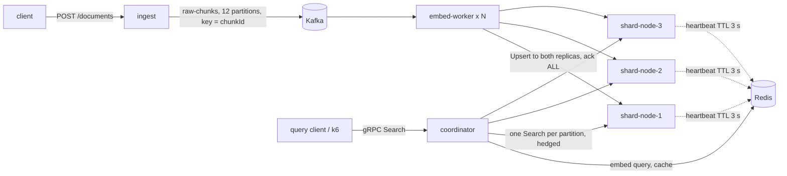

# Distributed Vector Search

A sharded, replicated semantic search service for text, built from scratch in Java 21. It ingests documents through
Kafka, embeds them with all-MiniLM-L6-v2 (ONNX Runtime, on CPU), stores the vectors in per-partition HNSW indexes
spread over three shard nodes with two replicas each, and answers queries with a scatter-gather over gRPC.

The test corpus is the first 2,000,000 MS MARCO passages: 2,015,656 chunks of 384-dimensional vectors.
Queries are the 101,093 MS MARCO dev queries.

Everything in this repository was built and measured on one laptop (Apple M4 Pro, 14 cores, 48 GB). The numbers
below come from that single machine. The load generator, coordinator, shard nodes, and Kafka all shared the same CPU.
See [Results](#results) and [docs/BENCHMARKS.md](docs/BENCHMARKS.md) for test conditions.

## Architecture



| module | role |
|---|---|
| `ingest` | REST `POST /documents`: chunk (128-word windows, 32-word overlap, ids `docId#i`), publish to Kafka with `acks=all` and an idempotent producer, reply 202 |
| `embed-worker` | Kafka consumer group: micro-batch, embed, write each chunk to both replicas of its partition, commit offsets only after both acknowledge (at-least-once + idempotent upserts) |
| `shard-node` | gRPC `ShardService`: one HNSW index per partition (hnswlib-core, M=16, efConstruction=200), write-ahead log + snapshots, Redis heartbeat |
| `coordinator` | gRPC `SearchService`: validate, Redis query cache, embed the query, scatter one request per partition, merge top-k with a bounded heap |
| `common` | consistent-hash ring, placement, Redis membership, rebalancer, Kafka topic layout |
| `embedding` | MiniLM on ONNX Runtime with the HuggingFace tokenizer; mean pooling + L2 normalization, verified against sentence-transformers |

### Data placement

- Consistent hashing with Murmur3 (64-bit) and 128 virtual nodes per physical node.
- A chunk's **primary** is the first vnode clockwise from `hash(chunkId)`. Its **replica** is the next vnode owned by
  a different physical node.
- A **partition** is the replica pair {primary, replica}. With 3 nodes there are 3 partitions, each stored on
  exactly 2 nodes, and each node stores 2 partitions. Because every partition has exactly two complete holders,
  replica selection, hedging and failover all reduce to "the other holder".
- Writes are acknowledged by both holders before the Kafka offset is committed (W = ALL, R = 1, N = 2). Any live
  holder can therefore serve reads. While a holder is down, indexing pauses and Kafka lag grows; queries and ingest
  keep working.
- Ring membership (where data lives) is stored separately from liveness (heartbeat keys with a TTL), so a crash
  does not trigger data movement. Adding or removing a node runs a rebalance: a pending ring, dual writes, a barrier
  until every writer and reader has seen the new ring, copying only the chunks that move, then cleanup.

### Query path

1. Validate, take the client's gRPC deadline (default 1 s), and check the Redis cache (key = normalized text + k, TTL 60 s).
2. Embed the query (about 1.4 ms on one core).
3. For each partition, pick a holder with power-of-two-choices over a peak-EWMA latency x in-flight cost, and send
   `Search` asynchronously. Each attempt gets min(query deadline minus 5 ms, now + 500 ms).
4. Hedging: if a partition has not answered after its rolling p95 (minimum 3 ms), send the same request to the other
   holder. The first answer wins. A token bucket caps hedges at 10% of requests.
5. Failures: on `UNAVAILABLE`, mark the node down at once and retry on the other holder. An attempt that hits the
   500 ms cap is also retried while the query still has time.
6. Merge with a size-k min-heap. If a partition has no answer, return the rest with `partial=true` and list the
   missing partitions. If nothing answered, return `UNAVAILABLE`. Partial answers are never cached.

### Durability

Every upsert is appended to a CRC-checked, fsynced write-ahead log before it is applied and acknowledged.
Snapshots are written every 5 minutes, or earlier once the WAL passes 256 MB. Each changed partition goes to a temp
file, is fsynced, and is atomically renamed, then the WAL is truncated. Startup loads the snapshots and replays the
WAL. Upserts are idempotent by chunk id, so replaying a write that is already in a snapshot is harmless.
Snapshots store vectors as fp16 on disk (memory stays fp32): 1,262 bytes per vector instead of 2,007, with
recall@10 unchanged to the fourth decimal on a 100k sample.

## How to run

Requirements: JDK 21, Docker (Docker Desktop or colima), Python 3 (standard library only), and k6 for load tests.

```bash
# 1. data: first 2M MS MARCO passages, dev queries, MiniLM ONNX model (~0.8 GB in data/)
scripts/fetch-data.sh

# 2. infrastructure: Kafka (KRaft), Redis, Prometheus, Grafana (dashboard at http://localhost:3000)
docker compose up -d

# 3. build and test (unit tests, plus integration tests with Testcontainers)
./gradlew build

# 4. cluster on the host
./gradlew -q :coordinator:clusterAdmin -Pargs="init node-1,node-2,node-3"
for n in 1 2 3; do JAVA_OPTS="-Xmx8g" scripts/cluster.sh shard $n; done
for i in $(seq 1 8); do JAVA_OPTS="-Xmx1g" scripts/cluster.sh worker $i --worker.intra-op-threads=1; done
scripts/cluster.sh ingest
JAVA_OPTS="-Xmx4g" scripts/cluster.sh coordinator

# 5. load documents and query
python3 scripts/bulk_ingest.py --count 100000        # omit --count for all 2M passages
./gradlew -q :coordinator:queryBench -Pargs="localhost:9100 show what is the manhattan project"
./gradlew -q :coordinator:clusterAdmin -Pargs="check"  # vectors per partition on each holder

# 6. load test and recall
scripts/k6_run.sh baseline -e STEPS=200,400,800,1200,1600 -e STEP_SECONDS=60
./gradlew -q :coordinator:recallCheck -Pargs="localhost:9100 500 10"   # start the coordinator with --coordinator.cache-enabled=false
scripts/chaos_run.sh kill-test 2 1200                  # kill -9 shard-2 at 60 s, restart at 120 s
```

The services also build as container images with Jib (`./gradlew jibDockerBuild`) and run under
`docker compose --profile app up -d`. That profile is sized for a small VM; the benchmark index ran on the host.

## Results

Conditions for every row: one laptop on AC power, everything co-located, 2,015,656 chunks indexed, k = 10, client
deadline 1 s. Load comes from k6's constant-arrival-rate executor (an open model, so a slow server cannot slow the
load generator down), with queries drawn uniformly at random from the 101,093 dev queries. Each step lasts 60 s.
Details, repeated runs and noise sources: [docs/BENCHMARKS.md](docs/BENCHMARKS.md).

| what | result |
|---|---|
| Ingest (REST to Kafka) | 2,015,656 chunks in 7.9 s |
| Indexing (Kafka to embed to both replicas) | ~740 chunks/s with 8 worker processes; CPU-bound (embedding + two HNSW inserts per chunk); ~45 min for the full corpus |
| Data integrity after load | indexed count = ingested count = committed Kafka offsets; both holders of every partition identical; 0 duplicate inserts |
| recall@10 vs exact brute force (500 queries, 2M vectors) | 0.9726 at efSearch 80 (default); 0.9400 at 40, 0.9854 at 160, 0.9944 at 320 |
| Max QPS with p99 < 100 ms and 0 errors, **cache off** | **1,600 QPS**, p50 6.1 ms, p99 62.6 ms |
| Same, cache on, warm cache | 3,200 QPS, p50 4.1 ms, p99 22.3 ms, but about 85% cache hits at that rate (cold cache: does not hold) |
| Hedged requests, healthy cluster | no p99 improvement; +0.5% partition requests |
| Hedged requests, one replica stalling 200 ms every 3 s | requests over 100 ms: 0 with hedging (losers kept running), 44 to 426 without |
| kill -9 of one shard node at 1,200 QPS | see [docs/BENCHMARKS.md](docs/BENCHMARKS.md#node-loss) |

What dominates the cost: per query, three partition searches (~1.3 ms each on a 600k-750k vector HNSW graph) plus
one query embedding (~1.4 ms). That puts 74% of the CPU in HNSW and 26% in embedding.

## Design trade-offs

- **Partition = replica pair.** This gives clean "ask the other holder" semantics, but the query fan-out grows as
  N(N-1)/2 with the node count. Beyond a handful of nodes, a fixed number of logical shards would be the better
  layout.
- **Write ack ALL instead of hinted handoff.** No replica ever serves stale data, and Kafka is the replay log.
  The cost is that indexing stops while any holder is down.
- **Coordinator-side embedding.** The query is embedded once, not once per shard, and shard nodes do not load the
  model. The coordinator becomes CPU-heavy, but it is stateless and scales horizontally.
- **Redis for membership.** It is simple and good enough for a few nodes. It is not strongly consistent, so the
  design tolerates short view disagreements (writes need both holders; reads retry and hedge).
- **Hedging that does not cancel the loser.** Cancelling the slower attempt removed it from the in-flight count and
  recorded only the hedge time, which hid a stalled replica from the load balancer. Letting it finish costs a little
  shard work but keeps the latency signal honest.
- **fp16 snapshots.** They cut disk use by 38% at a negligible recall cost; memory still holds fp32.

## Known gaps

- Single-machine measurements only. A multi-machine run is planned but has not been done; `docs/AWS.md` and
  `infra/aws/` contain an unapplied plan and a cost estimate.
- On a healthy co-located cluster, hedging does not lower p99. With hedging on, two of three healthy runs also
  showed one unexplained ~0.4 s global stall.
- A node that restarts receives traffic at once while it is still cold. The retry on per-attempt timeout covers
  correctness, but latency spikes for a few seconds. A slow-start ramp is not implemented.
- hnswlib deletes are soft. Updates and rebalances leave tombstones until the partition is rebuilt, and no rebuild
  job exists.
- A node that comes back with an empty disk is not detected automatically (`clusterAdmin repair` must be run first).
- Re-ingesting a document with fewer chunks leaves its old trailing chunks in the index.
- Kafka runs as a single broker locally (replication factor 1).
